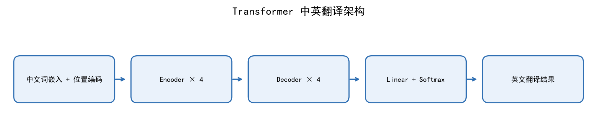
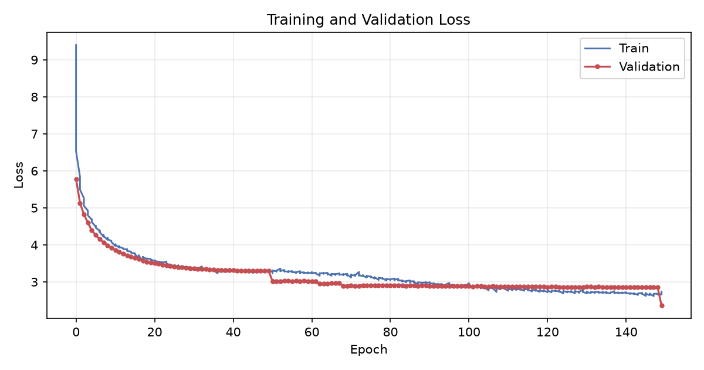
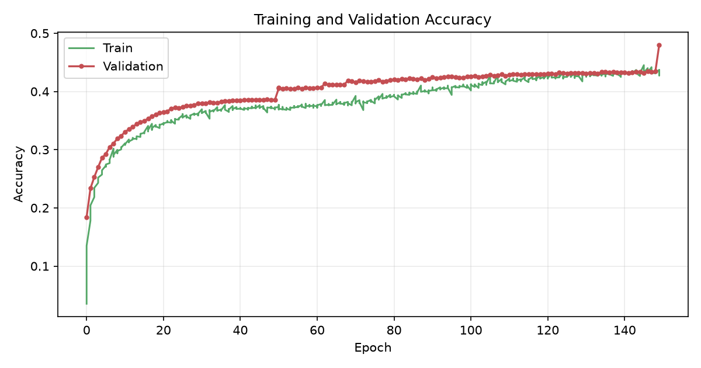
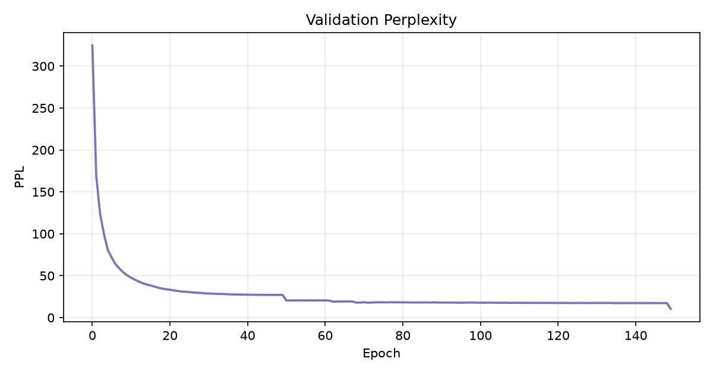
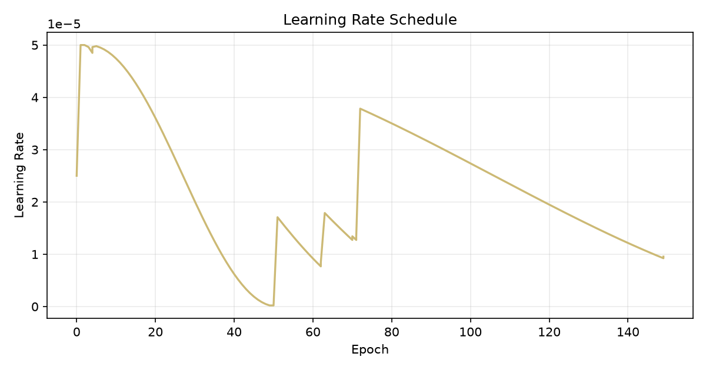

# Transformer 中英翻译

从零实现 Transformer 并完成中译英训练、验证和 beam search 推理的项目，适合学习注意力机制、位置编码和序列到序列建模。

## 项目概览

| 项目信息 | 内容 |
| --- | --- |
| 任务类型 | 中文到英文机器翻译 |
| 数据规模 | 100,000 对中英句对 |
| 模型结构 | 4 层编码器 + 4 层解码器，d_model=256，8 头注意力 |
| 训练规模 | 150 epochs，约 212,456 个训练 step |
| 最佳验证结果 | Loss 2.3622，Accuracy 0.4802，PPL 10.61 |
| 代码组成 | 12 个 Python 文件，约 1,530 行 |

## 目录

1. [项目背景](#项目背景)
2. [数据说明](#数据说明)
3. [模型结构](#模型结构)
4. [训练配置](#训练配置)
5. [训练过程](#训练过程)
6. [实验结果](#实验结果)
7. [环境要求](#环境要求)
8. [安装](#安装)
9. [快速开始](#快速开始)
10. [项目结构](#项目结构)
11. [复现说明](#复现说明)
12. [常见问题](#常见问题)

## 项目背景

机器翻译是自然语言处理中的经典序列到序列任务。Transformer 通过自注意力机制替代循环结构，能够并行建模长距离依赖，是当前大模型的基础架构之一。

本项目从零实现 Transformer 的各个子模块，并在 10 万对中英语料上完成训练与推理，用于理解注意力机制、位置编码、编码器-解码器结构和训练技巧。

## 数据说明

| 文件 | 内容 | 规模 |
| --- | --- | ---: |
| src/data/chinese.txt | 中文训练语料 | 100,000 行，约 13.6 MB |
| src/data/english.txt | 英文训练语料 | 100,000 行，约 17.8 MB |

数据格式为每行一个句子，中英文文件按行对齐，中文已按空格分词。样例：

| 语言 | 样例 |
| --- | --- |
| 中文 | 1998年 , 经过 统一 部署 , 伊犁州 , 地 两 级 党委 开始 尝试 ... |
| 英文 | in 1998 , the yili autonomous prefecture cpc committee ... |

训练脚本会构建词表，最大词表规模为 16,000，低频词映射为 UNK，句子最大长度为 160 个 token。

## 模型结构

| 模块 | 文件 | 作用 |
| --- | --- | --- |
| 输入嵌入 | src/dm01_input.py | 词嵌入 + 位置编码 |
| 注意力 | src/dm02_encoder_element.py | 缩放点积注意力、多头注意力、前馈网络、LayerNorm |
| 编码器 | src/dm03—dm05 | 编码器子层、编码器层和堆叠 |
| 解码器 | src/dm06—dm07 | 解码器子层、解码器层和堆叠 |
| 输出层 | src/dm08_output.py | Linear + Softmax 输出 |
| 模型组装 | src/dm09_transformer.py | 完整 Transformer |
| 训练/推理 | src/NiuTrans_train.py、src/inference.py | 训练、验证、beam search |

实现细节：

- 使用正弦位置编码，支持训练和推理阶段的序列长度变化；
- 注意力层包含缩放点积、多头拼接和输出投影；
- 编码器和解码器均使用残差连接和 LayerNorm；
- 解码器使用因果掩码，训练时并行计算，推理时逐词生成；
- 推理阶段支持 beam search，可配置 beam size。

## 训练配置

| 参数 | 取值 |
| --- | --- |
| d_model | 256 |
| n_head | 8 |
| n_layer | 4 |
| d_ff | 1024 |
| dropout | 0.2 |
| batch_size | 64 |
| epochs | 150 |
| optimizer | Adam |
| learning_rate | 1e-3 |
| warmup_epochs | 2 |
| scheduler | CosineAnnealing + warmup |
| gradient_clip | 1.0 |

训练脚本支持断点续训（checkpoint）、混合精度、学习率调度和最优模型保存。训练日志字段包括 Global_Step、Epoch、Type、Loss、Acc、PPL、LR 和 GradNorm。

## 训练过程

### 损失曲线

Loss 从约 9.4 降到约 2.7，验证损失在后半程稳定在 2.3—2.5 附近。

### 准确率曲线

训练准确率持续上升，验证准确率在第 120 轮之后趋于稳定，说明模型没有出现明显过拟合。

### 验证困惑度

验证 PPL 从训练初期的数百降到 10.61，表明模型学到了有效的中英映射。

### 学习率调度

前 2 个 epoch 进行 warmup，之后按余弦退火逐步衰减，帮助训练后期稳定收敛。

## 实验结果

原始训练日志约 212,456 个训练 step、150 个 epoch：

| 指标 | 数值 |
| --- | ---: |
| Val Loss | 2.3622 |
| Val Accuracy | 0.4802 |
| Val PPL | 10.61 |

综合来看，模型在 10 万对语料上完成了从随机初始化到稳定翻译的完整训练过程，适合作为 Transformer 学习和二次开发的基础实现。

## 环境要求

- Python 3.10+
- PyTorch 2.0+
- 依赖见 requirements.txt

建议使用带 CUDA 的 GPU 训练完整 150 个 epoch；CPU 环境可用于模块测试和小规模调试。

## 安装

~~~bash
git clone https://github.com/Smasun0721/transformer-zh-en-translation.git
cd transformer-zh-en-translation
pip install -r requirements.txt
~~~

## 快速开始

训练：

~~~bash
cd src
python NiuTrans_train.py
~~~

推理：

~~~bash
cd src
python inference.py
~~~

训练会在 src/checkpoints 下生成 best_model.pt 和 last_checkpoint.pt。

## 项目结构

~~~text
transformer-zh-en-translation/
├── src/
│   ├── dm01_input.py
│   ├── dm02_encoder_element.py
│   ├── dm03_encoder_sublayer.py
│   ├── dm04_encoder_layer.py
│   ├── dm05_encoder.py
│   ├── dm06_decoder_layer.py
│   ├── dm07_decoder.py
│   ├── dm08_output.py
│   ├── dm09_transformer.py
│   ├── NiuTrans_train.py
│   ├── inference.py
│   ├── plot_metrics.py
│   └── data/
│       ├── chinese.txt
│       └── english.txt
├── reports/
│   ├── training_log.csv
│   ├── loss_curve.png
│   ├── accuracy_curve.png
│   ├── perplexity_curve.png
│   └── learning_rate_curve.png
├── docs/architecture.png
├── requirements.txt
└── README.md
~~~

## 复现说明

- 训练日志 reports/training_log.csv 记录了每个 logging step 的 Loss、Acc、PPL、LR 和 GradNorm。
- 训练权重约 240MB，未直接提交到仓库；可先运行训练脚本生成，或放到 GitHub Releases / Hugging Face 后在 README 中补充下载地址。
- 推理脚本使用训练时同一套空格分词词表，避免推理阶段重建词表造成索引错位。

## 常见问题

**Q：训练时显存不足怎么办？**  
减小 batch_size，或开启梯度累积；也可以先在小规模数据上验证流程。

**Q：推理结果乱码或不对齐？**  
确认推理脚本和训练脚本使用同一份词表、同一套分词方式。

**Q：没有 GPU 能复现吗？**  
可以用 CPU 跑少量 step 验证代码，但完整 150 epoch 训练建议使用 GPU。

## 后续优化

- 使用 BLEU / chrF 等机器翻译指标评估生成质量。
- 增加 BPE/SentencePiece 子词分词和长度惩罚。
- 尝试梯度累积、多卡训练和模型导出（ONNX / TorchScript）。
- 提供 FastAPI 翻译服务或 Web Demo。
